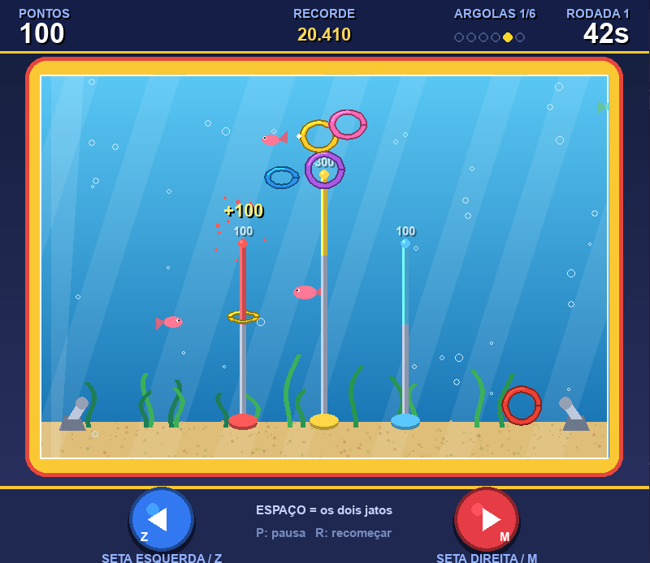

  <h1>🌊 Argolas Aquáticas (Waterful Ring Toss)</h1>
  
<em>Uma recriação nostálgica em Python/Pygame do clássico brinquedo aquático dos anos 90, desenvolvida com física de fluidos simulada e síntese procedural de áudio em tempo real — sem necessidade de assets externos.</em>

  

    
    
    
    
    
  

   

  

    
     
    🔍 Clique na imagem para abrir em tamanho real
  

  

<h2>🎯 Destaques Técnicos</h2>

<ul>
  <li><strong>Física e Dinâmica de Fluidos:</strong> Simulação de arrasto hidrodinâmico, empuxo, correntes de jato vetoriais e amortecimento de colisão para reproduzir o comportamento de objetos flutuando na água.</li>
  <li><strong>Síntese de Áudio Procedural:</strong> Sons sintetizados matematicamente via <code>array</code> de ondas (senoidais e quadradas com modulação de frequência e ruído branco) integrados diretamente ao <code>pygame.mixer</code>, dispensando arquivos <code>.wav</code> ou <code>.mp3</code>.</li>
  <li><strong>Renderização Gráfica Vetorial:</strong> Toda a interface gráfica, tanque, peixes, bolhas e reflexos são gerados em tempo de execução via primitivas do Pygame e cálculos trigonométricos.</li>
  <li><strong>Mecânica de Jogo Completa:</strong> Sistema de pontuação balanceado com combos temporizados, argolas especiais (ouro x3), tempo regressivo, fases progressivas e persistência de recorde local (<code>highscore</code>).</li>
</ul>

<h2>🎮 Controles</h2>

<table>
  <thead>
    <tr>
      <th align="left">Ação</th>
      <th align="left">Teclado</th>
      <th align="left">Mouse</th>
    </tr>
  </thead>
  <tbody>
    <tr>
      <td><strong>Jato Esquerdo</strong></td>
      <td><kbd>Seta Esquerda</kbd> ou <kbd>Z</kbd></td>
      <td>Clique no botão azul</td>
    </tr>
    <tr>
      <td><strong>Jato Direito</strong></td>
      <td><kbd>Seta Direita</kbd> ou <kbd>M</kbd></td>
      <td>Clique no botão vermelho</td>
    </tr>
    <tr>
      <td><strong>Ambos os Jatos</strong></td>
      <td><kbd>Barra de Espaço</kbd></td>
      <td>—</td>
    </tr>
    <tr>
      <td><strong>Pausar</strong></td>
      <td><kbd>P</kbd></td>
      <td>—</td>
    </tr>
    <tr>
      <td><strong>Reiniciar / Novo Jogo</strong></td>
      <td><kbd>R</kbd></td>
      <td>Clique na tela (telas de menu/fim)</td>
    </tr>
    <tr>
      <td><strong>Sair</strong></td>
      <td><kbd>ESC</kbd></td>
      <td>Fechar janela</td>
    </tr>
  </tbody>
</table>

<h2>🕹️ Regras do Jogo</h2>

<ul>
  <li><strong>Objetivo:</strong> Acertar as argolas nos pinos antes do cronômetro zerar.</li>
  <li><strong>Pinos Laterais:</strong> 100 pontos.</li>
  <li><strong>Pino Central:</strong> 300 pontos.</li>
  <li><strong>Argola Dourada:</strong> Multiplica o valor do encaixe por 3.</li>
  <li><strong>Combos:</strong> Encaixes consecutivos dentro da janela de tempo concedem multiplicadores de até 5x.</li>
</ul>

<h2>🚀 Como Executar</h2>

<h3>Pré-requisitos</h3>
<ul>
  <li>Python 3.10 ou superior instalado.</li>
</ul>

<h3>Passo a Passo</h3>
<pre><code># 1. Clone o repositório
git clone https://github.com/Edinaldo-long/argolas-aquaticas.git
cd argolas-aquaticas

# 2. Crie e ative um ambiente virtual (opcional)
python -m venv venv
# No Windows:
venv\Scripts\activate

# 3. Instale a dependência
pip install pygame

# 4. Inicie o jogo
python argolas_aquaticas.py</code></pre>

<h2>🛠️ Tecnologias Utilizadas</h2>

<ul>
  <li><strong>Linguagem:</strong> Python</li>
  <li><strong>Biblioteca Multimídia:</strong> Pygame</li>
  <li><strong>Módulos Nativos:</strong> <code>math</code>, <code>random</code>, <code>array</code>, <code>sys</code>, <code>os</code></li>
</ul>

<h2>👤 Autor</h2>

  Desenvolvido por <strong>Edinaldo Santos de Almeida</strong> 
  

  Licenciado sob a Licença MIT. Desenvolvido para fins de estudo de física hidrodinâmica 2D, síntese sonora e computação gráfica.

